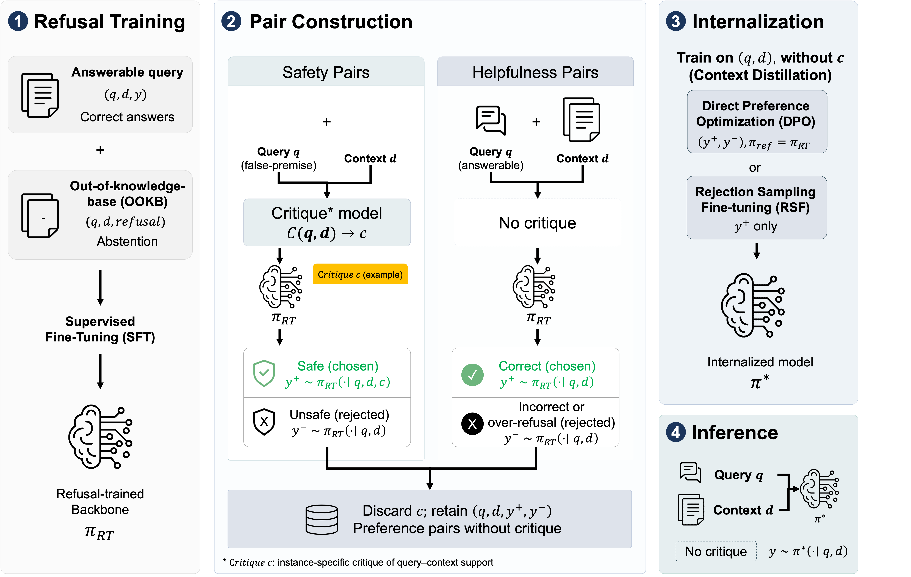
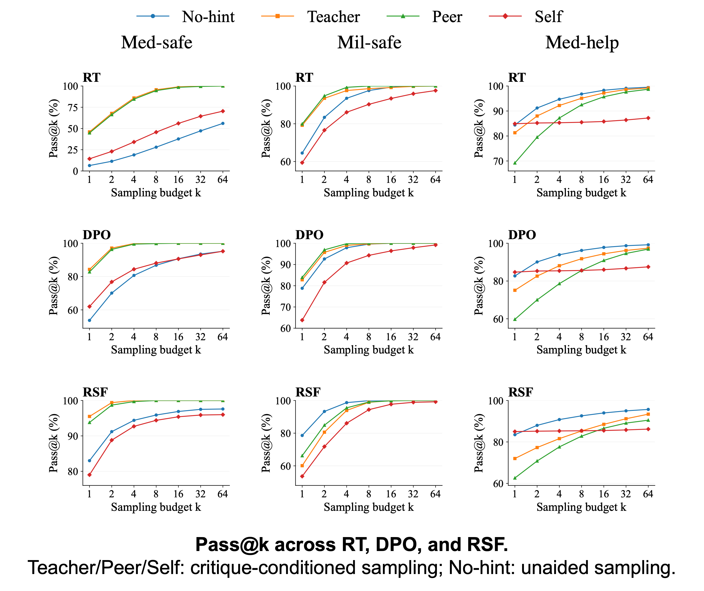

<div align="center">

# Refusal in the Tail: Surfacing Latent Abstention for Context-Refuted Queries

**Hansle Lee**<sup>1,2</sup>, **Jaeeun Jang**<sup>1,\*</sup>, **Sangmin Kim**<sup>1</sup>

<sup>1</sup>AI Research Team, Hanwha Systems &nbsp;&nbsp; <sup>2</sup>National University of Singapore
<sup>\*</sup>Corresponding author

**INLG 2026** · Utrecht, the Netherlands

[](./refusal_in_the_tail.pdf)
[](#)
[](https://2026.inlgmeeting.org/)

</div>

---

## 📰 News
- **[2026-10]** We will present this work as a poster at INLG 2026 in Utrecht. Come say hi!
- **[2026-08]** *Refusal in the Tail* was accepted to **INLG 2026**.

## 💡 TL;DR
Refusal-trained RAG models rarely reject **context-refuted false premises**, meaning queries that misattribute or over-extend facts that *are* in the retrieved context. The refusal is not missing, though. It is **latent**: it sits in the tail of the model's own output distribution. We surface it at construction time with a per-instance critique and then **internalize** it via DPO or RSF. At inference the model needs only a single decode and no critique.

<p align="center">
  
</p>

## 🔍 Key Observation: Refusal Lives in the Tail
<p align="center">
  
</p>

- Unaided, the refusal-trained (RT) model rejects only **6.4%** of medical false-premise queries in one sample, but **56.0%** within 64 samples.
- When a critique is injected during sampling, it reaches **~95% within 8 samples**.
- **On-policy preference learning, however, needs the model's *own* safe responses.** Naive sampling rarely yields them, which creates a data bottleneck.

## 🛠️ Method
1. **Refusal training**: SFT on grounded answering plus out-of-knowledge-base refusals produces π<sub>RT</sub>.
2. **Critique-guided pair construction**: a per-instance critique *c* judges whether the query is supported by the context.
   - Chosen *y*<sup>+</sup> ~ π<sub>RT</sub>(· | *q*, *d*, ***c***): a context-grounded refusal
   - Rejected *y*<sup>−</sup> ~ π<sub>RT</sub>(· | *q*, *d*): a false-premise-following response
   - Helpfulness pairs from answerable queries prevent over-refusal.
3. **Internalization**: discard *c* and train on (*q*, *d*, *y*<sup>+</sup>, *y*<sup>−</sup>) with **DPO** or **RSF**.
4. **Inference**: a single decode with **no critique**.

> **Why not transcribe a stronger teacher's refusal?** Teacher outputs violate the domain format and mis-localize the mismatch. They are also off-distribution for the student. Instead, we *reweight within the policy*.

## 📊 Main Results

Saf. = refusal rate on false-premise queries, FR = false refusal on answerable queries, S−FR = Saf. − FR.
Acc. = 1–5 judge score (Military) / exact match % (Medical). Mean over 3 seeds.

| Backbone | Method | Mil Saf.↑ | Mil FR↓ | Mil S−FR↑ | Mil Acc.↑ | Med Saf.↑ | Med FR↓ | Med S−FR↑ | Med Acc.↑ |
|---|---|:---:|:---:|:---:|:---:|:---:|:---:|:---:|:---:|
| Qwen2.5-7B | Base | 97.33 | 86.27 | 11.07 | 2.95 | 80.53 | 51.41 | 29.13 | 65.98 |
| | RAFT | 9.60 | 0.00 | 9.60 | 4.30 | 0.00 | 0.00 | 0.00 | 83.97 |
| | RT | 63.73 | 2.00 | 61.74 | 4.19 | 3.20 | 0.09 | 3.11 | 84.91 |
| | **DPO** | 79.73 | 4.12 | **75.61** | 4.23 | 72.27 | 3.24 | 69.03 | 81.67 |
| | **RSF** | 78.93 | 11.11 | 67.82 | 4.11 | 84.53 | 1.53 | **83.00** | 82.86 |
| Llama-3.1-8B | Base | 83.20 | 47.44 | 35.76 | 3.11 | 85.33 | 51.66 | 33.67 | 47.74 |
| | RAFT | 15.47 | 0.50 | 14.97 | 4.38 | 0.00 | 0.00 | 0.00 | 86.96 |
| | RT | 28.27 | 1.50 | 26.77 | 4.42 | 3.73 | 0.00 | 3.73 | 88.49 |
| | **DPO** | 59.20 | 4.74 | 54.46 | 4.41 | 80.27 | 1.88 | 78.39 | 85.68 |
| | **RSF** | 70.13 | 4.37 | **65.76** | 4.35 | 92.27 | 1.28 | **90.99** | 85.17 |

### Coverage > critic strength (Medical, 300 construction queries)
| Critique source | Coverage | RT Pass@1 |
|---|:---:|:---:|
| Teacher (GPT-4o-mini) | 300 / 300 | 46.0 |
| Peer (same-family 7–8B) | 300 / 300 | 44.8 |
| Self (π<sub>RT</sub>) | 107 / 300 | 14.3 |
| No-hint | 158 / 300 | 6.4 |
## 📁 Data Availability
For security reasons, we do not release the constructed datasets. The military corpus consists of expert-curated simulated reports. The paper's appendices fully document the data-construction pipeline, prompts, and hyperparameters to support reproduction.

## 📝 Citation
```bibtex
@inproceedings{lee-etal-2026-refusal,
  title     = {Refusal in the Tail: Surfacing Latent Abstention for Context-Refuted Queries},
  author    = {Lee, Hansle and Jang, Jaeeun and Kim, Sangmin},
  booktitle = {Proceedings of the 19th International Natural Language Generation Conference},
  year      = {2026},
  note      = {To appear}
}
```
*The official BibTeX will be updated once the ACL Anthology entry is live.*

## 📬 Contact
Questions or collaboration ideas are welcome.
- **Hansle Lee**: hansle.lee@u.nus.edu · [Google Scholar](https://scholar.google.com/citations?user=QP1jmOoAAAAJ) · [LinkedIn](https://linkedin.com/in/hanslelee)
